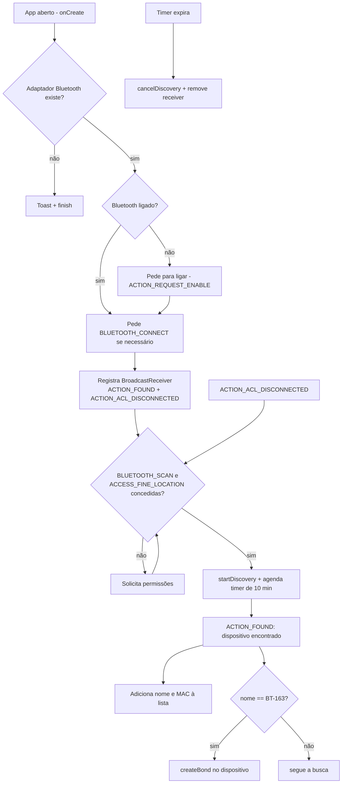

# CarBluetooth
Automatic pairing and connection to car bluetooth dongle, dongle has a defect and requires connection every time

## Lógica de funcionamento

O app tem uma única tela (`MainActivity`) que procura dispositivos Bluetooth próximos, lista o que encontrou e, ao detectar o dongle do carro (nome **`BT-163`**), dispara automaticamente o pareamento com ele. A ideia é abrir o app ao entrar no carro e deixar que ele refaça a conexão que o dongle perde.

### Fluxo



### Etapas em detalhe

1. **Inicialização (`onCreate`)**
   - Monta a lista (`ListView` + `ArrayAdapter`) com o cabeçalho "Dispositivos Bluetooth".
   - Obtém o `BluetoothAdapter` via `BluetoothManager`. Sem adaptador, avisa e encerra.
   - Se o Bluetooth estiver desligado, abre o diálogo do sistema para ligá-lo (`ACTION_REQUEST_ENABLE`).
   - Solicita `BLUETOOTH_CONNECT`, necessária a partir do Android 12 para ler o nome dos dispositivos e parear.

2. **Escuta de eventos** — um único `BroadcastReceiver` é registrado para dois eventos:
   - `BluetoothDevice.ACTION_FOUND`: um dispositivo foi encontrado na busca.
   - `BluetoothDevice.ACTION_ACL_DISCONNECTED`: alguma conexão Bluetooth caiu.

3. **Busca (`checkAndStartDiscovery`)**
   - Verifica `BLUETOOTH_SCAN` e `ACCESS_FINE_LOCATION`; se faltar alguma, pede as permissões e, na resposta (`onRequestPermissionsResult`), chama a própria função de novo.
   - Com as permissões, chama `startDiscovery()` e agenda `afterTimeCancelDiscoveryAndReceiver()`.

4. **Dispositivo encontrado (`ACTION_FOUND`)**
   - Lê o `BluetoothDevice` do intent (API nova no Android 13+, API depreciada antes).
   - Adiciona `nome (MAC)` à lista na tela.
   - Se o nome for `BT-163`, chama `pairAndConnect()`, que invoca `createBond()` no dispositivo. Depois do pareamento, a conexão de áudio fica a cargo do próprio Android, que conecta automaticamente aos perfis (A2DP/HFP) de um dispositivo recém-pareado.

5. **Reconexão (`ACTION_ACL_DISCONNECTED`)** — quando uma conexão cai, a busca é reiniciada, para que o dongle seja encontrado e pareado de novo.

6. **Encerramento**
   - Um `Timer` cancela a busca e remove o receiver após **10 minutos** (`10 * 60 * 1000` ms), limitando o consumo de bateria.
   - `onStop` remove o receiver e `onDestroy` também cancela a busca. Ou seja, a reconexão automática só funciona enquanto o app está em primeiro plano.

### Permissões (`AndroidManifest.xml`)

| Permissão | Uso |
|---|---|
| `BLUETOOTH_SCAN` | Iniciar/cancelar a busca (Android 12+) |
| `BLUETOOTH_CONNECT` | Ler nome do dispositivo e parear (Android 12+) |
| `ACCESS_FINE_LOCATION` / `ACCESS_COARSE_LOCATION` | Exigidas pela busca Bluetooth |
| `BLUETOOTH` / `BLUETOOTH_ADMIN` | Permissões legadas (Android ≤ 11) |

`minSdk = 31` (Android 12), `targetSdk = 34`.

### Configuração

O nome do dongle está fixo em `MainActivity.kt`:

```kotlin
private val targetDeviceName = "BT-163"
```

Para usar com outro dongle, troque esse valor pelo nome que ele anuncia.
<!--
### Limitações conhecidas

- **Busca curta:** o Android encerra cada `startDiscovery()` após ~12 s. Como `ACTION_DISCOVERY_FINISHED` não é tratado, a busca não recomeça sozinha dentro da janela de 10 min; só reinicia em um `ACTION_ACL_DISCONNECTED`.
- **Dispositivo já pareado:** `createBond()` retorna `false` se o dongle já estiver pareado, e o app não chama `connect` em nenhum perfil. Se o defeito do dongle exigir reconexão sem perder o pareamento, é preciso conectar via `BluetoothA2dp`/`BluetoothHeadset` (ou remover o pareamento antes).
- **Toast no timer:** o `Toast` em `afterTimeCancelDiscoveryAndReceiver()` roda na thread do `Timer`, sem `Looper`, o que lança exceção ao fim dos 10 min. Envolver em `runOnUiThread { ... }` resolve.
- **Destaque em vermelho:** o texto `<font color='red'>` aparece literal na lista, pois o `ArrayAdapter` simples não interpreta HTML.
- **Comentário do timer:** o comentário diz "10 seconds", mas o valor configurado é 10 minutos.
- **Permissão negada:** `onRequestPermissionsResult` chama `checkAndStartDiscovery()` sem checar o resultado, então uma recusa faz o pedido reaparecer.
- **Primeiro plano apenas:** para reconectar com a tela apagada ou o app fechado, a lógica teria de ir para um `Service` em primeiro plano ou um receiver registrado no manifest.
-->
