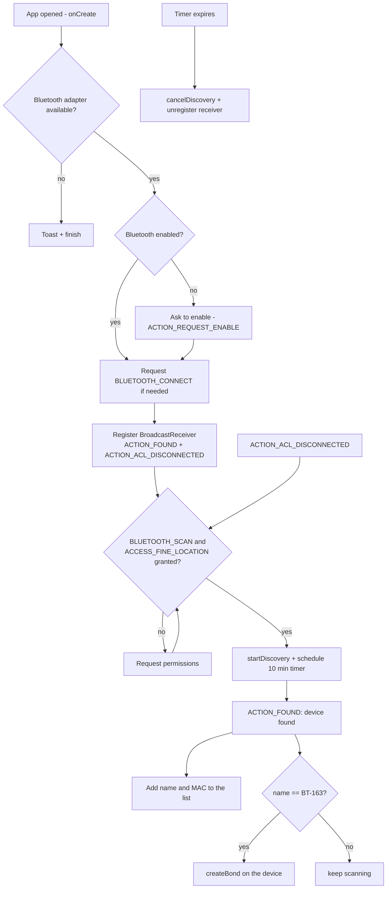
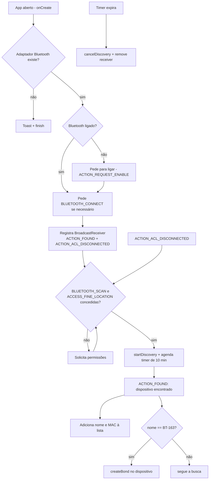

# CarBluetooth

🇺🇸 [English](#english) | 🇧🇷 [Português](#português)

---

## English

Automatic pairing and connection to a car Bluetooth dongle. The dongle has a defect and needs to be reconnected every time.

### How it works

The app has a single screen (`MainActivity`) that scans for nearby Bluetooth devices and lists what it finds. When it detects the car dongle (named **`BT-163`**), it automatically starts pairing with it. The idea is to open the app when getting into the car and let it restore the connection the dongle keeps losing.

#### Flow



#### Steps in detail

1. **Startup (`onCreate`)**
   - Builds the list (`ListView` + `ArrayAdapter`) with the header "Dispositivos Bluetooth".
   - Gets the `BluetoothAdapter` from `BluetoothManager`. If there is no adapter, it shows a warning and exits.
   - If Bluetooth is off, it opens the system dialog to turn it on (`ACTION_REQUEST_ENABLE`).
   - Requests `BLUETOOTH_CONNECT`, required since Android 12 to read device names and pair.

2. **Event listening.** A single `BroadcastReceiver` is registered for two events:
   - `BluetoothDevice.ACTION_FOUND`: a device was found during the scan.
   - `BluetoothDevice.ACTION_ACL_DISCONNECTED`: some Bluetooth connection dropped.

3. **Scan (`checkAndStartDiscovery`)**
   - Checks `BLUETOOTH_SCAN` and `ACCESS_FINE_LOCATION`. If either is missing, it requests them and calls itself again in the response (`onRequestPermissionsResult`).
   - With the permissions granted, it calls `startDiscovery()` and schedules `afterTimeCancelDiscoveryAndReceiver()`.

4. **Device found (`ACTION_FOUND`)**
   - Reads the `BluetoothDevice` from the intent (new API on Android 13+, deprecated API before that).
   - Adds `name (MAC)` to the on-screen list.
   - If the name is `BT-163`, it calls `pairAndConnect()`, which invokes `createBond()` on the device. After pairing, Android itself handles the audio connection, automatically connecting to the profiles (A2DP/HFP) of a newly paired device.

5. **Reconnection (`ACTION_ACL_DISCONNECTED`).** When a connection drops, the scan restarts so the dongle can be found and paired again.

6. **Shutdown**
   - A `Timer` cancels the scan and unregisters the receiver after **10 minutes** (`10 * 60 * 1000` ms), to limit battery drain.
   - `onStop` unregisters the receiver and `onDestroy` also cancels the scan. This means automatic reconnection only works while the app is in the foreground.

### Permissions (`AndroidManifest.xml`)

| Permission | Purpose |
|---|---|
| `BLUETOOTH_SCAN` | Start/cancel the scan (Android 12+) |
| `BLUETOOTH_CONNECT` | Read device names and pair (Android 12+) |
| `ACCESS_FINE_LOCATION` / `ACCESS_COARSE_LOCATION` | Required by Bluetooth scanning |
| `BLUETOOTH` / `BLUETOOTH_ADMIN` | Legacy permissions (Android ≤ 11) |

`minSdk = 31` (Android 12), `targetSdk = 34`.

### Configuration

The dongle name is hardcoded in `MainActivity.kt`:

```kotlin
private val targetDeviceName = "BT-163"
```

To use another dongle, change this value to the name it advertises.

<!--
### Known limitations

- **Short scan:** Android ends each `startDiscovery()` after about 12 s. Since `ACTION_DISCOVERY_FINISHED` is not handled, the scan does not restart on its own within the 10 min window; it only restarts on an `ACTION_ACL_DISCONNECTED`.
- **Already paired device:** `createBond()` returns `false` if the dongle is already paired, and the app does not call `connect` on any profile. If the dongle defect requires reconnecting without losing the pairing, the app needs to connect through `BluetoothA2dp`/`BluetoothHeadset` (or remove the pairing first).
- **Toast in the timer:** the `Toast` in `afterTimeCancelDiscoveryAndReceiver()` runs on the `Timer` thread, which has no `Looper`, so it throws an exception when the 10 minutes are up. Wrapping it in `runOnUiThread { ... }` fixes it.
- **Red highlight:** the `<font color='red'>` text shows up literally in the list, because the plain `ArrayAdapter` does not interpret HTML.
- **Timer comment:** the comment says "10 seconds", but the configured value is 10 minutes.
- **Denied permission:** `onRequestPermissionsResult` calls `checkAndStartDiscovery()` without checking the result, so a denial makes the request show up again.
- **Foreground only:** to reconnect with the screen off or the app closed, the logic would have to move to a foreground `Service` or a receiver registered in the manifest.
-->

---

## Português

Pareamento e conexão automáticos com o dongle Bluetooth do carro. O dongle tem um defeito e precisa ser reconectado toda vez.

### Lógica de funcionamento

O app tem uma única tela (`MainActivity`) que procura dispositivos Bluetooth próximos e lista o que encontrou. Ao detectar o dongle do carro (nome **`BT-163`**), ele dispara automaticamente o pareamento. A ideia é abrir o app ao entrar no carro e deixar que ele refaça a conexão que o dongle perde.

#### Fluxo



#### Etapas em detalhe

1. **Inicialização (`onCreate`)**
   - Monta a lista (`ListView` + `ArrayAdapter`) com o cabeçalho "Dispositivos Bluetooth".
   - Obtém o `BluetoothAdapter` via `BluetoothManager`. Sem adaptador, avisa e encerra.
   - Se o Bluetooth estiver desligado, abre o diálogo do sistema para ligá-lo (`ACTION_REQUEST_ENABLE`).
   - Solicita `BLUETOOTH_CONNECT`, necessária a partir do Android 12 para ler o nome dos dispositivos e parear.

2. **Escuta de eventos.** Um único `BroadcastReceiver` é registrado para dois eventos:
   - `BluetoothDevice.ACTION_FOUND`: um dispositivo foi encontrado na busca.
   - `BluetoothDevice.ACTION_ACL_DISCONNECTED`: alguma conexão Bluetooth caiu.

3. **Busca (`checkAndStartDiscovery`)**
   - Verifica `BLUETOOTH_SCAN` e `ACCESS_FINE_LOCATION`. Se faltar alguma, pede as permissões e, na resposta (`onRequestPermissionsResult`), chama a própria função de novo.
   - Com as permissões, chama `startDiscovery()` e agenda `afterTimeCancelDiscoveryAndReceiver()`.

4. **Dispositivo encontrado (`ACTION_FOUND`)**
   - Lê o `BluetoothDevice` do intent (API nova no Android 13+, API depreciada antes).
   - Adiciona `nome (MAC)` à lista na tela.
   - Se o nome for `BT-163`, chama `pairAndConnect()`, que invoca `createBond()` no dispositivo. Depois do pareamento, a conexão de áudio fica a cargo do próprio Android, que conecta automaticamente aos perfis (A2DP/HFP) de um dispositivo recém-pareado.

5. **Reconexão (`ACTION_ACL_DISCONNECTED`).** Quando uma conexão cai, a busca é reiniciada, para que o dongle seja encontrado e pareado de novo.

6. **Encerramento**
   - Um `Timer` cancela a busca e remove o receiver após **10 minutos** (`10 * 60 * 1000` ms), limitando o consumo de bateria.
   - `onStop` remove o receiver e `onDestroy` também cancela a busca. Ou seja, a reconexão automática só funciona enquanto o app está em primeiro plano.

### Permissões (`AndroidManifest.xml`)

| Permissão | Uso |
|---|---|
| `BLUETOOTH_SCAN` | Iniciar/cancelar a busca (Android 12+) |
| `BLUETOOTH_CONNECT` | Ler nome do dispositivo e parear (Android 12+) |
| `ACCESS_FINE_LOCATION` / `ACCESS_COARSE_LOCATION` | Exigidas pela busca Bluetooth |
| `BLUETOOTH` / `BLUETOOTH_ADMIN` | Permissões legadas (Android ≤ 11) |

`minSdk = 31` (Android 12), `targetSdk = 34`.

### Configuração

O nome do dongle está fixo em `MainActivity.kt`:

```kotlin
private val targetDeviceName = "BT-163"
```

Para usar com outro dongle, troque esse valor pelo nome que ele anuncia.

<!--
### Limitações conhecidas

- **Busca curta:** o Android encerra cada `startDiscovery()` após ~12 s. Como `ACTION_DISCOVERY_FINISHED` não é tratado, a busca não recomeça sozinha dentro da janela de 10 min; só reinicia em um `ACTION_ACL_DISCONNECTED`.
- **Dispositivo já pareado:** `createBond()` retorna `false` se o dongle já estiver pareado, e o app não chama `connect` em nenhum perfil. Se o defeito do dongle exigir reconexão sem perder o pareamento, é preciso conectar via `BluetoothA2dp`/`BluetoothHeadset` (ou remover o pareamento antes).
- **Toast no timer:** o `Toast` em `afterTimeCancelDiscoveryAndReceiver()` roda na thread do `Timer`, sem `Looper`, o que lança exceção ao fim dos 10 min. Envolver em `runOnUiThread { ... }` resolve.
- **Destaque em vermelho:** o texto `<font color='red'>` aparece literal na lista, pois o `ArrayAdapter` simples não interpreta HTML.
- **Comentário do timer:** o comentário diz "10 seconds", mas o valor configurado é 10 minutos.
- **Permissão negada:** `onRequestPermissionsResult` chama `checkAndStartDiscovery()` sem checar o resultado, então uma recusa faz o pedido reaparecer.
- **Primeiro plano apenas:** para reconectar com a tela apagada ou o app fechado, a lógica teria de ir para um `Service` em primeiro plano ou um receiver registrado no manifest.
-->
